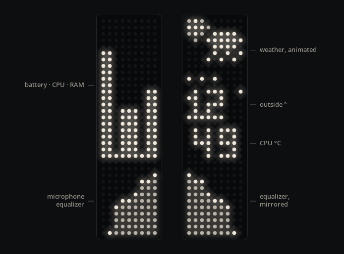

# Framework LED Matrix dashboard

A small Linux daemon that turns the two 9×34 **LED Matrix input modules** of a
[Framework Laptop 16](https://frame.work/laptop16) into a live system dashboard, with a GTK tray
icon for brightness, on/off and what the bars show.

[](https://unrasend.github.io/fw-led-dashboard/)

*Drawn by the dashboard's own renderers; the equalizer plays a made-up song.*
**[Live demo with every weather icon →](https://unrasend.github.io/fw-led-dashboard/)**

```bash
wget -qO- https://github.com/Unrasend/fw-led-dashboard/releases/latest/download/install.sh | bash
```

## Features

- **Left panel:** three bars — battery, CPU and RAM by default; each can show battery, CPU,
  RAM, GPU, swap or disk `/` — and a microphone spectrum below them.
- **Right panel:** weather for your location (Open-Meteo, no API key), outside temperature,
  CPU temperature and the spectrum.
- **Alerts:** only the critical value blinks, at 1 Hz, with hysteresis — battery ≤ 10 %,
  less than 5 % RAM free for 10 s, CPU at 120 °C. CPU-usage and outside-temperature limits are
  optional.
- **Tray icon (GTK 3):** on/off switch, brightness slider, *Swap panels* switch and a submenu
  per bar; every data source has a tooltip saying where its numbers come from. Choices survive
  restarts.
- **Runs unattended:** systemd user service; recovers from suspend/resume, USB reconnects,
  PipeWire restarts and network loss (the last weather reading is shown for up to 2 h).
- **Light:** about 6 frames per second per panel (the firmware's grayscale limit) at ~5 % of
  one CPU core and ~20 MB of memory.

## Requirements

- Framework Laptop 16 with **two** LED Matrix input modules (stock firmware).
- Linux with a systemd user session, PipeWire or PulseAudio (`parec`) and Python ≥ 3.11.
- For the tray: GTK 3 and an X11 panel that shows classic tray icons (XFCE, KDE Plasma, MATE,
  Cinnamon, …). The daemon works without the tray, including on Wayland.

| Distribution | Packages |
|---|---|
| Arch / Manjaro | `python python-pyserial python-gobject python-cairo gtk3 libpulse` |
| Debian / Ubuntu | `python3 python3-venv python3-serial python3-gi python3-gi-cairo gir1.2-gtk-3.0 pulseaudio-utils` |
| Fedora | `python3 python3-pyserial python3-gobject python3-cairo gtk3 pulseaudio-utils` |

The panels are `/dev/ttyACM*` serial devices. Most desktops grant them to the logged-in user
automatically (`uaccess`); otherwise add yourself to `uucp` (Arch) or `dialout` (Debian,
Fedora) and log in again.

Developed and tested on Manjaro with XFCE on X11. Other setups should work but have not been
tried — reports are welcome.

## Install

Install the packages above, then, as your normal user (no `sudo`):

```bash
wget -qO- https://github.com/Unrasend/fw-led-dashboard/releases/latest/download/install.sh | bash
```

This downloads the latest release into `~/.local/share/framework-led-dashboard/src` and runs
its `install.sh`. With `curl` instead of `wget`:

```bash
curl -fsSL https://github.com/Unrasend/fw-led-dashboard/releases/latest/download/install.sh | bash
```

Prefer to read the script before running it, or to work from a checkout? Download it, or
clone the repository — `install.sh` does the same from there:

```bash
git clone https://github.com/Unrasend/fw-led-dashboard.git
```

```bash
cd fw-led-dashboard && ./install.sh
```

The installer:

1. creates a venv in `~/.local/share/framework-led-dashboard/venv` that reuses the system
   packages above (no Python packages are downloaded) and installs the dashboard into it;
2. detects both panels and writes `~/.config/framework-led-dashboard/config.toml` — only if
   it does not exist yet;
3. installs, enables and starts the `framework-led-dashboard` systemd user service;
4. adds the tray icon to `~/.config/autostart` and starts it;
5. disables the older `inputmodule-rs` audio visualizer service (`framework-matrix.service`) if
   you have it — only one program can own the panels; it is not deleted.

**Bars on the right and weather on the left?** Turn on *Swap panels* in the tray menu; the
panels swap at once and the choice is kept.

**Update:** run the same `wget … | bash` line again (or `git pull` and `./install.sh` in a
checkout). **Remove** — stops and removes the service, tray entry, venv and downloaded source;
keeps your config and tray settings:

```bash
wget -qO- https://github.com/Unrasend/fw-led-dashboard/releases/latest/download/install.sh | bash -s -- --uninstall
```

or `./install.sh --uninstall` in a checkout.

## Using it

**Tray icon** (amber when on, grey when off, red dot when the dashboard is not running):
left click opens the menu — the *LED Matrix* switch, the *Brightness* slider (drag, click or
scroll), the *Swap panels* switch (bars on the right, weather on the left) and *Left panel bars*
with one submenu per bar. Right click offers *Quit tray*; quitting the tray never touches the
panels. Brightness, on/off, the swap and the bar choice are stored in
`~/.local/state/framework-led-dashboard/display.json`.

**Service:**

```bash
systemctl --user status framework-led-dashboard
```

```bash
journalctl --user -u framework-led-dashboard -f
```

```bash
systemctl --user restart framework-led-dashboard
```

It restarts after a crash (2 s, growing to 60 s) but not after a configuration error — fix the
config and restart it.

**Command line** (`~/.local/share/framework-led-dashboard/venv/bin/framework-led-dashboard`):

| Option | Does |
|---|---|
| `--list-panels` | print the connected LED Matrix modules and their USB identities |
| `--check-config PATH` | validate a config and print it normalized |
| `--init-config TEMPLATE PATH` | write a new config from a template with both panels filled in |
| `--run PATH` | run the dashboard in the foreground until Ctrl+C / SIGTERM |
| `--tray` | show the tray icon |

## Configuration

`~/.config/framework-led-dashboard/config.toml` — see [`config.example.toml`](config.example.toml).
Restart the service after editing it.

| Key | Default | Meaning |
|---|---|---|
| `brightness_percent` | `40` | starting brightness; the tray overrides it |
| `animation_fps` | `10` | frame-rate cap per panel (the hardware tops out near 7) |
| `swap_panels` | `false` | starting value of the tray's *Swap panels* switch; the tray overrides it |
| `panels.left.identity`, `panels.right.identity` | detected | USB serial or location from `--list-panels` |
| `location.latitude`, `location.longitude` | unset | fixed coordinates for the weather; skips geolocation |
| `location.ip_lookup_enabled` | `true` | allow IP geolocation via ipwho.is |
| `location.ip_lookup_ttl_seconds` | `21600` | how long an IP location is reused |
| `location.vpn_interface_prefixes` | `tun, tap, wg, …` | while such an interface is up, IP lookup is skipped |
| `updates.metrics_seconds` | `1` | local sensors |
| `updates.weather_seconds` | `900` | weather refresh |
| `alerts.*` | see example | blink thresholds with separate recovery values |

**Location and privacy:** explicit coordinates win. Otherwise the IP-based location is used
only when no VPN is detected (so a VPN exit country never ends up in the cache), then the last
cached location, then the city of the system time zone. Weather requests send only coordinates.

## Troubleshooting

| Symptom | What to check |
|---|---|
| Panels stay dark | `journalctl --user -u framework-led-dashboard`; another program (e.g. an `inputmodule-control` visualizer) may hold the serial ports |
| `Permission denied` on `/dev/ttyACM*` | the `uaccess` / group notes under Requirements |
| Sides swapped | *Swap panels* in the tray menu |
| Equalizer stays dark | `parec` installed? The log says `microphone unavailable` when there is no capture |
| Weather shows `--` | no network for over 2 h, or no location — set `latitude`/`longitude` |
| No tray icon | needs GTK 3 and an X11 tray with classic icons; the daemon keeps working without it |
| Panels freeze for a few seconds after resume | expected: they reconnect on their own |

## How it works

One process owns both panels: a sender thread per panel, a 1 Hz sensor loop, a weather loop,
a `parec` capture with a small FFT for the spectrum, and a Unix socket
(`$XDG_RUNTIME_DIR/framework-led-dashboard.sock`, owner-only) for the tray. Renderers are pure
functions from state to a 9×34 grayscale frame.

Firmware details worth knowing if you write your own LED Matrix code:

- **One command per USB packet.** The firmware parses only the first command of each packet,
  so every `StageGreyCol` must be its own `write()`; a frame sent in one write is silently cut.
- **Grayscale is slow.** A frame is 9 column commands plus a commit, ~14 ms each: about
  7 FPS per panel. `DrawBW` reaches ~60 FPS but has no mid-levels.
- **Waking takes seconds.** Any command wakes a sleeping panel, which then ignores USB during
  its fade-in (up to ~5 s). The dashboard wakes it with a query and waits for the answer.
- **Brightness below level 5 flashes.** The fade-in computes `level - 5` on a `u8`, so levels
  0–4 overflow and the panel flares to full brightness first; the dashboard never goes below 5.
- **Identical serial numbers.** Both modules may report the same USB serial; they are told
  apart by USB location.

## Development

```bash
uvx --with pyserial pytest
```

```bash
uvx ruff check src tests
```

```bash
PYTHONPATH=src python3 -m framework_led_dashboard --run ~/.config/framework-led-dashboard/config.toml
```

Stop the service before running from the checkout — only one dashboard can own the panels.
Layout: `src/framework_led_dashboard/` (daemon, renderers, transport, tray), `tests/`
(including golden frames in `tests/goldens/`), `packaging/` (systemd unit, tray autostart
entry), `install.sh`, and `docs/` — the GitHub Pages demo. Its frames come from the real
renderers; after changing one, regenerate them (a test fails until you do):

```bash
PYTHONPATH=src python3 scripts/build_demo_data.py
```

The animated picture at the top (`docs/preview.gif`) comes from the same renderers; re-render
it with pycairo and Pillow installed:

```bash
PYTHONPATH=src python3 scripts/build_readme_gif.py
```

## License

[MIT](LICENSE)
