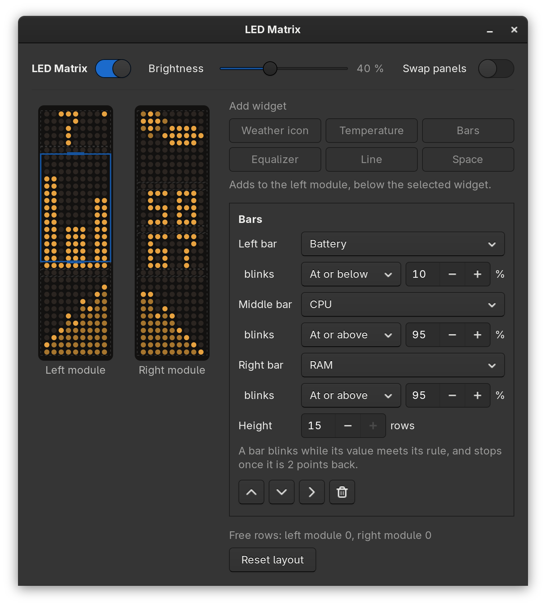

# Framework LED Matrix dashboard

A small Linux daemon that turns the two 9×34 **LED Matrix input modules** of a
[Framework Laptop 16](https://frame.work/laptop16) into a live system dashboard. You choose
what each module shows in a small settings window; a GTK tray icon keeps on/off, brightness
and the panel swap at hand.

[](https://unrasend.github.io/fw-led-dashboard/)

*Drawn by the dashboard's own renderers; the equalizer plays a made-up song.*
**[Live demo with every weather icon →](https://unrasend.github.io/fw-led-dashboard/)**

```bash
wget -qO- https://github.com/Unrasend/fw-led-dashboard/releases/latest/download/install.sh | bash
```

## Features

- **Widgets you arrange:** each module shows a stack of widgets, top to bottom:
  - **weather icon** for your location (Open-Meteo, no API key), animated;
  - **temperature** of the CPU, the GPU (the graphics module if it is in, else the built-in
    one) or outside;
  - **three bars**, each showing battery, CPU, RAM, GPU, swap or disk `/`, as tall as you
    like;
  - **equalizer** of your microphone or of what the laptop plays — in stereo across both
    modules;
  - **separators**: a lit line or empty space.
- **Default layout:** the outside temperature over battery, CPU and RAM bars on the left;
  weather, GPU and CPU temperature on the right; the equalizer along the bottom of both,
  mirrored so the bass meets in the middle.
- **Alerts:** only the critical value blinks, at 1 Hz. Each bar has its own rule — at or
  above, or at or below a percentage, or never; by default CPU and RAM at 95 % and more,
  battery at 10 % and less. The CPU temperature blinks from 120 °C (set your own); an
  outside-temperature range is optional.
- **Settings window (GTK 3):** both modules drawn LED for LED with what they show right now;
  click a widget to change it, drag it to move it, drag its top or bottom edge to resize it.
  It runs only while it is open — [see it below](#using-it).
- **Tray icon:** on/off, brightness and *Swap panels*. It works in KDE Plasma (X11 and
  Wayland), GNOME (with the AppIndicator extension, which Ubuntu ships and the installer can
  add), XFCE, Cinnamon, MATE and others; the *LED Matrix Dashboard* window from the
  application menu works everywhere, tray or not. Choices survive restarts.
- **Runs unattended:** systemd user service; recovers from suspend/resume, USB reconnects,
  PipeWire restarts and network loss (the last weather reading is shown for up to 2 h).
- **Light:** about 6 frames per second per panel (the firmware's grayscale limit) for about
  20 ms of CPU time per second on a Ryzen 7 7840HS with the microphone (~28 ms with the system
  sound in stereo), most of it the equalizer's FFT, and ~20 MB of memory. With the panels off,
  or no equalizer in the layout, nothing is captured and it drops to ~1.5 ms per second.

## Requirements

- Framework Laptop 16 with **two** LED Matrix input modules (stock firmware).
- Linux with a systemd user session and Python ≥ 3.11 — Ubuntu 24.04, Fedora 39, Debian 12,
  Arch and newer. The dashboard itself uses nothing but Python's standard library.
- The installer checks for the rest and offers to install it with your package manager
  (pacman, apt, dnf or zypper), asking once:

| What | For | Arch | Debian / Ubuntu | Fedora |
|---|---|---|---|---|
| PyGObject with cairo, GTK 3 | tray icon, settings window | `python-gobject python-cairo gtk3` | `python3-gi python3-gi-cairo gir1.2-gtk-3.0` | `python3-gobject gtk3` |
| `parec` (or PipeWire's `pw-record`) | equalizer | `libpulse` | `pulseaudio-utils` | `pulseaudio-utils` |
| AppIndicator extension, GNOME only | a tray on GNOME | `gnome-shell-extension-appindicator` | (preinstalled on Ubuntu) | `gnome-shell-extension-appindicator` |

Most desktops already have all of it. On Fedora Silverblue, Kinoite or Bazzite the installer
prints the `rpm-ostree install` line instead, since layering needs a reboot.

The panels are `/dev/ttyACM*` serial devices. Most desktops grant them to the logged-in user
automatically (`uaccess`); otherwise add yourself to `uucp` (Arch) or `dialout` (Debian,
Fedora) and log in again.

Developed and run daily on Manjaro with XFCE on X11. The StatusNotifierItem tray for KDE,
GNOME and the rest is tested against its D-Bus protocol and XFCE's StatusNotifier host, not
yet on KDE or GNOME themselves — reports from other desktops and distributions are welcome.

## Install

Install the packages above, then, as your normal user (no `sudo`):

```bash
wget -qO- https://github.com/Unrasend/fw-led-dashboard/releases/latest/download/install.sh | bash
```

This downloads the latest release into `~/.local/share/framework-led-dashboard/src` and runs
its `install.sh`. With `curl` instead of `wget`:

```bash
curl -fsSL https://github.com/Unrasend/fw-led-dashboard/releases/latest/download/install.sh | bash
```

Prefer to read the script before running it, or to work from a checkout? Download it, or
clone the repository — `install.sh` does the same from there:

```bash
git clone https://github.com/Unrasend/fw-led-dashboard.git
```

```bash
cd fw-led-dashboard && ./install.sh
```

The installer:

1. offers to install the missing system packages above (`--yes` installs them without asking,
   `--no-packages` never touches them);
2. copies the program to `~/.local/share/framework-led-dashboard` — no venv, no pip, no
   downloads from PyPI;
3. detects both panels and writes `~/.config/framework-led-dashboard/config.toml` — only if
   it does not exist yet;
4. installs, enables and starts the `framework-led-dashboard` systemd user service;
5. starts the tray icon and adds it to `~/.config/autostart`, and adds *LED Matrix Dashboard*
   to the application menu;
6. disables the older `inputmodule-rs` audio visualizer service (`framework-matrix.service`) if
   you have it — only one program can own the panels; it is not deleted.

**Bars on the right and weather on the left?** Turn on *Swap panels* in the tray menu or the
settings window; the panels swap at once and the choice is kept.

**Update:** run the same `wget … | bash` line again (or `git pull` and `./install.sh` in a
checkout). **Remove** — stops and removes the service, the tray, the menu entry and the
program; keeps your config and tray settings:

```bash
wget -qO- https://github.com/Unrasend/fw-led-dashboard/releases/latest/download/install.sh | bash -s -- --uninstall
```

or `./install.sh --uninstall` in a checkout.

### Docker (optional)

The dashboard can run in a container instead, isolated from the rest of your session:

```bash
./install.sh --docker
```

(or `… | bash -s -- --docker` from the web). It builds an Alpine image
(`framework-led-dashboard:<version>`, about 120 MB) and points the same systemd user service at
`~/.local/share/framework-led-dashboard/bin/framework-led-dashboard-docker`, which runs it.
The tray and the settings window stay on the desktop, so GTK is still installed there. Updates
keep the variant; `./install.sh --native` goes back and removes the image.

The container gets only what the daemon needs — no `--privileged`:

- the two LED Matrix modules' serial ports and no other device: not your `/dev`, and not
  another serial device you plug in (an Arduino, a modem). A module that comes back under
  another port, say after a resume, starts the container again with it — the panels go dark
  for a few seconds;
- sysfs, read-only as Docker always mounts it (ports, battery, temperatures, GPU load);
- the PipeWire and Pulse sockets for the equalizer, and a folder of its own,
  `$XDG_RUNTIME_DIR/framework-led-dashboard`, for the control socket — never the whole
  runtime directory, with your session bus and agents in it;
- the config (read-only), the display settings and the location cache;
- a Docker network of its own for the weather; its DNS asks your desktop's resolver from the
  desktop's side, so NetBird, Tailscale or systemd-resolved work behind a firewall like ufw.

It runs as you, without capabilities or new privileges, on a read-only root. It starts with
your session like the plain service: a container Docker starts at boot would find neither the
sound server nor the runtime folder. Run `framework-led-dashboard-docker --print` to see the
exact `docker run` command.

Differences: the container cannot see a VPN, so it never looks your location up by IP — it
uses `latitude`/`longitude` from the config, the last cached location, or your time zone's city.
The *Disk* bar shows the file system Docker keeps its containers on. PipeWire is required (it
is on every current desktop distribution).

## Using it

<p align="center">
  
</p>

**Settings window** — *LED Matrix Dashboard* in the application menu, or *Settings…* in the
tray. On top: on/off, a brightness slider and *Swap panels*. Below, both modules as they look
right now, with an outline around each widget:

- click a widget to select it; its settings appear on the right — the source of a
  temperature (and, for the CPU, the temperature it blinks from, 40–150 °C), the source of
  each bar and when it blinks, the sound of the equalizer, the style of a separator, the
  height;
- drag it onto empty rows (spaces or the free rows at the bottom) to put it exactly there —
  nothing else moves; drag it onto other widgets, or onto the other module, to slot it in
  between them;
- drag the bottom edge of bars, the equalizer or a space to resize it, pushing what is below;
  drag its top edge to move only the border with the widget above (a space above gives or
  takes the rows); *Delete* removes it;
- *Add widget* puts a new one below the selected widget. A module has 34 rows, so make room
  first: remove a widget or make bars, the equalizer or a space smaller;
- *Reset layout* goes back to the default.

Every change applies at once. The window is a process of its own that exits when you close
it, so it takes no memory the rest of the time.

**Equalizer sound** — *Microphone*, or *System sound*: what the laptop plays (the default
output's monitor, following it to headphones or HDMI). With an equalizer on both modules the
system sound is shown in stereo, the left channel on the left module and the right channel on
the right one.

**Tray icon** (amber when on, grey when off, red dot when the dashboard is not running). Its
menu has on/off, brightness in steps, *Swap panels* and *Settings…*; it looks a little
different per desktop:

- *KDE Plasma, GNOME, Cinnamon, Budgie, …* (StatusNotifierItem): right click opens the menu,
  left click the settings window, middle click switches the LED Matrix on or off, and
  scrolling over the icon changes the brightness.
- *XFCE, MATE on X11*: left click opens a popup with a real switch and slider, right click
  *Settings…* and *Quit tray*.
- *GNOME without the AppIndicator extension* has no tray at all: use the menu entry.
  `LED_DASHBOARD_TRAY=sni|xembed|none` overrides the guess.

Quitting the tray never touches the panels. Brightness, on/off, the swap, the layout, the
equalizer's sound and the CPU alert are stored in
`~/.local/state/framework-led-dashboard/display.json`; settings saved by 1.3 or older move into
the default layout with their bar sources.

**Service:**

```bash
systemctl --user status framework-led-dashboard
```

```bash
journalctl --user -u framework-led-dashboard -f
```

```bash
systemctl --user restart framework-led-dashboard
```

It restarts after a crash (2 s, growing to 60 s) but not after a configuration error — fix the
config and restart it.

**Command line** (`~/.local/share/framework-led-dashboard/bin/framework-led-dashboard`):

| Option | Does |
|---|---|
| `--list-panels` | print the connected LED Matrix modules and their USB identities |
| `--check-config PATH` | validate a config and print it normalized |
| `--init-config TEMPLATE PATH` | write a new config from a template with both panels filled in |
| `--run PATH` | run the dashboard in the foreground until Ctrl+C / SIGTERM |
| `--tray` | show the tray icon |
| `--settings` | open the settings window (or raise it if it is open) |

## Configuration

`~/.config/framework-led-dashboard/config.toml` — see [`config.example.toml`](config.example.toml).
Restart the service after editing it.

| Key | Default | Meaning |
|---|---|---|
| `brightness_percent` | `40` | starting brightness; the tray and the settings window override it |
| `animation_fps` | `10` | frame-rate cap per panel (the hardware tops out near 7) |
| `swap_panels` | `false` | starting value of *Swap panels*; the tray and the settings window override it |
| `panels.left.identity`, `panels.right.identity` | detected | USB serial or location from `--list-panels` |
| `location.latitude`, `location.longitude` | unset | fixed coordinates for the weather; skips geolocation |
| `location.ip_lookup_enabled` | `true` | allow IP geolocation via ipwho.is |
| `location.ip_lookup_ttl_seconds` | `21600` | how long an IP location is reused |
| `location.vpn_interface_prefixes` | `tun, tap, wg, …` | while such an interface is up, IP lookup is skipped |
| `updates.metrics_seconds` | `1` | local sensors |
| `updates.weather_seconds` | `900` | weather refresh |
| `alerts.*` | see example | the CPU temperature's blink threshold and recovery (the widget's *Blink from* overrides `cpu_temperature_critical_c` and keeps the gap) and the optional outside range. Bars blink by their rules in the settings window; the older `battery_*`, `ram_*` and `cpu_usage_critical_percent` keys are ignored |

**Location and privacy:** explicit coordinates win. Otherwise the IP-based location is used
only when no VPN is detected (so a VPN exit country never ends up in the cache), then the last
cached location, then the city of the system time zone. Weather requests send only coordinates.

## Troubleshooting

| Symptom | What to check |
|---|---|
| Panels stay dark | `journalctl --user -u framework-led-dashboard`; another program (e.g. an `inputmodule-control` visualizer) may hold the serial ports |
| `Permission denied` on `/dev/ttyACM*` | the `uaccess` / group notes under Requirements |
| Sides swapped | *Swap panels* in the tray menu or the settings window |
| Equalizer stays dark | `parec` or `pw-record` installed? The log says `sound unavailable` when there is no capture. With *System sound*, is anything playing? |
| GPU temperature shows a dim `--` | the graphics module is asleep (it is not woken up to read it), or the driver has no hwmon sensor (NVIDIA's own driver) |
| Weather shows `--` | no network for over 2 h, or no location — set `latitude`/`longitude` |
| Docker: weather shows `--`, the log says `fetch failed` | a firewall or VPN client blocks the container's traffic. As a last resort share the desktop's network: `systemctl --user edit framework-led-dashboard` → `[Service]` `Environment=LED_DASHBOARD_DOCKER_NETWORK=host` — less isolated: the container then reaches what listens on the desktop's loopback |
| No tray icon | GNOME: enable the *AppIndicator and KStatusNotifierItem Support* extension (the installer offers it), then log in again. Elsewhere: run `install.sh` again for PyGObject/GTK 3. The *LED Matrix Dashboard* menu entry works either way |
| Panels freeze for a few seconds after resume | expected: they reconnect on their own |

## How it works

One process owns both panels: a sender thread per panel, a 1 Hz sensor loop, a weather loop,
a `parec` (or `pw-record`) capture with a small FFT for the spectrum, and a Unix socket
(`$XDG_RUNTIME_DIR/framework-led-dashboard/control.sock`, owner-only) for the tray and the settings
window, which also asks it for the frames it shows. The renderer is a pure function from
state and a layout (a stack of widgets per panel) to a 9×34 grayscale frame.

Where the CPU time goes, and how it is kept down (pure Python, no numpy):

- **Spectrum:** 31 windows of 512 samples a second per channel. The 512 real samples go
  through one 256-point complex FFT and only the bins up to 6 kHz are unpacked; samples are
  converted a whole window at a time. Two channels are analysed only for the system sound
  with an equalizer on both modules. The capture stops while the panels are off or no
  equalizer is in the layout.
- **Panels:** each grayscale frame is 10 USB writes. A frame identical to the one shown is
  skipped, with a resend every 2 s so a panel that lost its picture gets it back.
- **Sensors:** hwmon and DRM directories are searched once a minute, not every second. A
  runtime-suspended GPU is never read, so polling does not wake it.

Firmware details worth knowing if you write your own LED Matrix code:

- **One command per USB packet.** The firmware parses only the first command of each packet,
  so every `StageGreyCol` must be its own `write()`; a frame sent in one write is silently cut.
- **Grayscale is slow.** A frame is 9 column commands plus a commit, ~14 ms each: about
  7 FPS per panel. `DrawBW` reaches ~60 FPS but has no mid-levels.
- **Waking takes seconds.** Any command wakes a sleeping panel, which then ignores USB during
  its fade-in (up to ~5 s). The dashboard wakes it with a query and waits for the answer.
- **Brightness below level 5 flashes.** The fade-in computes `level - 5` on a `u8`, so levels
  0–4 overflow and the panel flares to full brightness first; the dashboard never goes below 5.
- **Identical serial numbers.** Both modules may report the same USB serial; they are told
  apart by USB location.

## Development

```bash
uvx pytest
```

```bash
uvx ruff check src tests
```

```bash
PYTHONPATH=src python3 -m framework_led_dashboard --run ~/.config/framework-led-dashboard/config.toml
```

Stop the service before running from the checkout — only one dashboard can own the panels.
Layout: `src/framework_led_dashboard/` (daemon, layout and renderer, transport, tray,
settings window), `Dockerfile` (the optional container), `tests/`
(including golden frames in `tests/goldens/`), `packaging/` (systemd units, Docker wrapper, tray autostart
entry), `install.sh`, and `docs/` — the GitHub Pages demo. Its frames come from the real
renderers; after changing one, regenerate them (a test fails until you do):

```bash
PYTHONPATH=src python3 scripts/build_demo_data.py
```

The animated picture at the top (`docs/preview.gif`) comes from the same renderer and the
default layout; re-render it with pycairo and Pillow installed:

```bash
PYTHONPATH=src python3 scripts/build_readme_gif.py
```

The settings window screenshot (`docs/settings-window.png`) is the real window with made-up
data, drawn off screen; `broadwayd :7` keeps it off your desktop:

```bash
GDK_BACKEND=broadway BROADWAY_DISPLAY=:7 PYTHONPATH=src python3 scripts/build_settings_screenshot.py
```

## License

[MIT](LICENSE)
